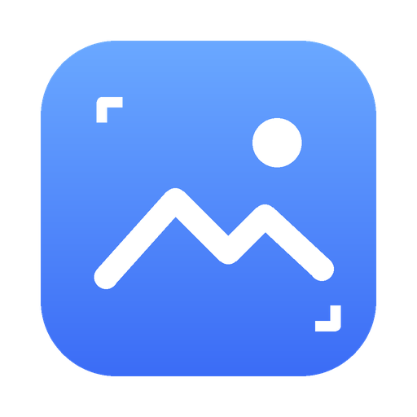
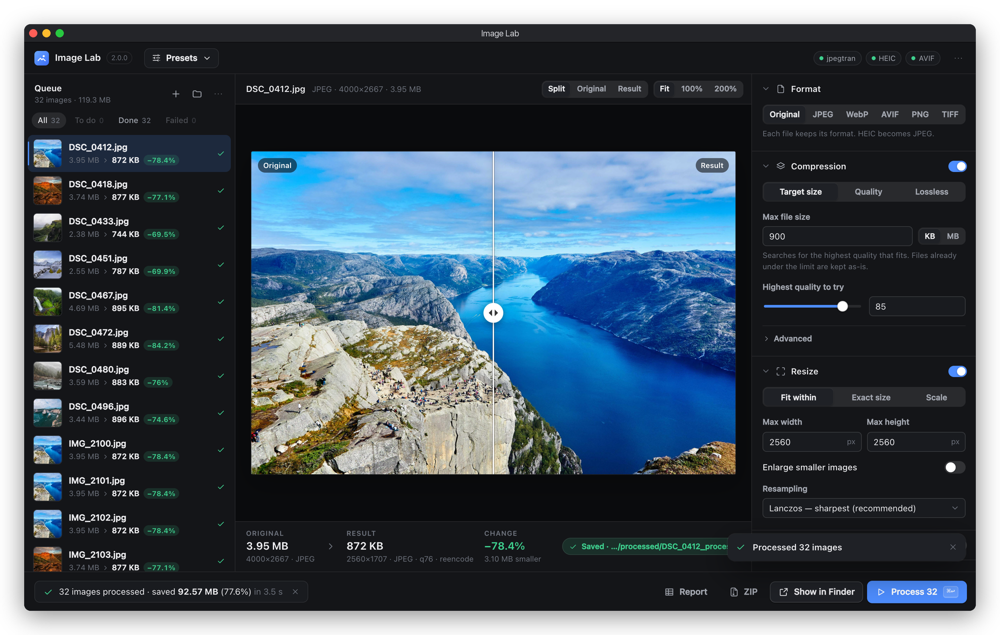
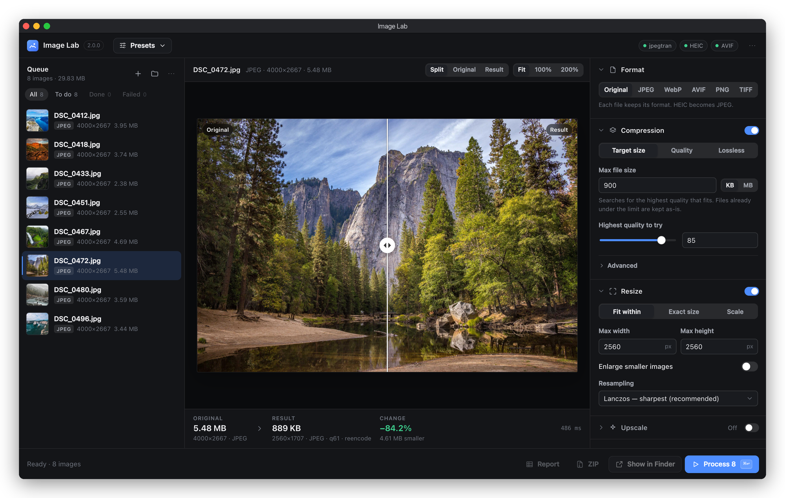
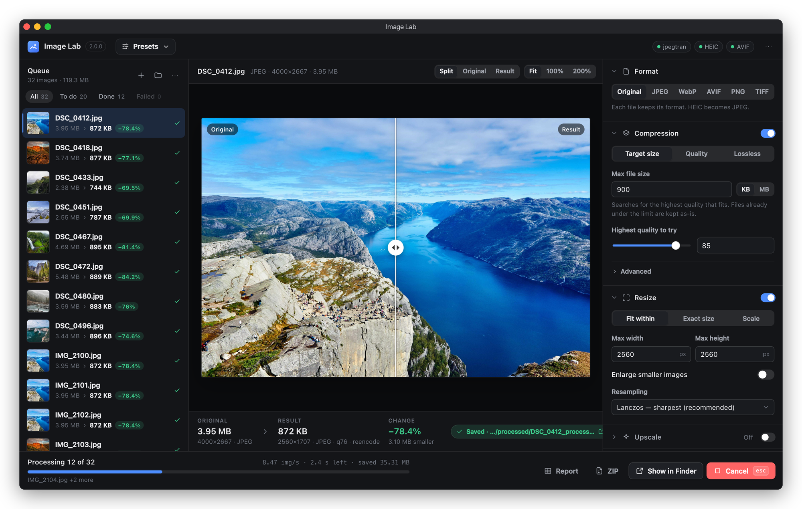
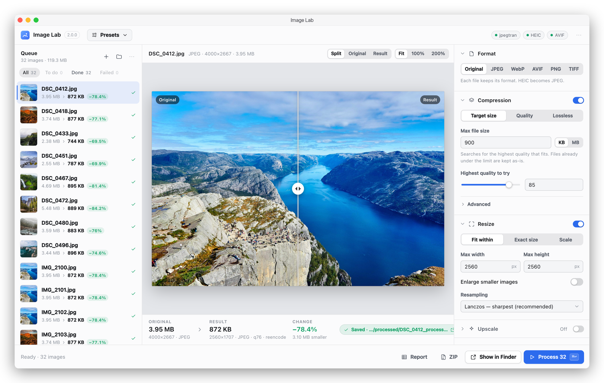

<p align="center">
  
</p>

<h1 align="center">Image Lab</h1>

<p align="center">
  <strong>Fast, local batch image compression for macOS</strong><br>
  Drop a folder · hit a file-size target · see the before and after · nothing leaves your Mac
</p>

<p align="center">
  
  
  
</p>

<p align="center">
  
</p>

---

## Download

1. Download **Image-Lab-…-arm64.dmg** from the [latest release](https://github.com/MRJOHN5ON/image-lab/releases/latest).
2. Open the DMG and drag **Image Lab** into **Applications**.
3. Open Image Lab. The first time, macOS says it can't verify the developer (the app isn't signed with a paid Apple Developer certificate). Go to **System Settings → Privacy & Security**, scroll down, click **Open Anyway** next to the Image Lab message, and confirm. You only do this once.

**You need:** an Apple Silicon Mac (M1 or newer) on macOS 12 or later. Nothing else: Python, the image engine and jpegtran are all inside the app. It works fully offline.

Logs: `~/Library/Logs/Image Lab/image-lab.log`

### Troubleshooting

**"Image Lab is damaged and can't be opened"**: macOS sometimes says this about downloaded unsigned apps. Run this once in Terminal, then open the app again:

```bash
xattr -dr com.apple.quarantine "/Applications/Image Lab.app"
```

**macOS asks for access to Desktop, Documents or Downloads**: Image Lab needs it to read the photos you add from there and save the results next to them. Click **Allow**.

**Intel Mac**: the download is Apple Silicon only. Use [Dev mode](#dev-mode) instead.

---

## Build the app yourself

```bash
git clone https://github.com/MRJOHN5ON/image-lab.git
cd image-lab
scripts/build_release.sh 2.0.0
```

Needs an Apple Silicon Mac with [uv](https://docs.astral.sh/uv/getting-started/installation/), Node.js 18+, and the Xcode Command Line Tools (`xcode-select --install`). The script fetches its own Python, runs the test suite, builds the UI and a static jpegtran, then bundles everything with PyInstaller. It checks that the bundle doesn't depend on anything outside itself, runs a real batch inside the built app as a smoke test, and writes `dist/release/Image-Lab-2.0.0-arm64.dmg` (about 23 MB).

Publishing a release: push a tag like `v2.0.0` and the [Release workflow](.github/workflows/release.yml) builds the DMG on GitHub and attaches it to a draft release. Review the draft, then publish it. Or build locally and run `scripts/build_release.sh 2.0.0 --publish`.

---

## What Image Lab does

**Image Lab** shrinks, resizes and converts photos in bulk, entirely on your Mac. No uploads, no accounts, no limits. Give it a folder of camera JPEGs and a size like "under 900 KB": it finds the highest quality that fits, for every file, on every CPU core.

| Feature | Description |
|---------|-------------|
| **Target file size** | Set a limit in KB or MB; each image gets the best quality that fits under it |
| **Quality and lossless modes** | Fixed quality, or lossless optimisation (jpegtran for JPEG) that never changes a pixel |
| **Live before/after** | Drag the split slider, zoom to 100% or 200%, and see the exact size before you process |
| **Bulk speed** | A pool of worker processes keeps every core busy while the window stays responsive |
| **Resize and upscale** | Fit within, exact size (crop or pad) or percentage, with Lanczos resampling |
| **Convert** | JPEG, WebP, AVIF, PNG and TIFF out; HEIC, GIF and BMP in too |
| **Presets** | Web gallery, Email / upload limit, Social / OG image, Thumbnails and more, or save your own |
| **Safe output** | Writes to a `processed/` folder by default, never makes a file larger, atomic writes, and keeps or strips metadata as you choose |
| **Finish** | Show in Finder, save everything as a ZIP, or export a CSV report |
| **Dark and light** | Follows your system, or pick one |

<p align="center">
  
</p>

<p align="center">
  
</p>

<p align="center">
  
</p>

### How to use

1. Drop images or whole folders onto the window, or press **⌘O** (files) or **⇧⌘O** (folder)
2. Pick a preset, or set the format, compression, resize and output options on the right
3. Select any image to preview the result. Hold **Space** to see the original
4. Press **Process** (**⌘↩**). Results go to a `processed/` folder next to the originals
5. **Show in Finder**, **ZIP** or **Report** when it's done

### How fast?

On an M-series MacBook, 32 photos (4000×2667 JPEGs, 119 MB in total) were resized to 2560 px and compressed to under 900 KB each in **3.5 seconds**, saving 92.6 MB (78%). The UI stays interactive the whole time: work runs in separate processes, so you can keep adding files, previewing and scrolling during a batch.

---

## Dev mode

Try changes without building the `.app`:

```bash
git clone https://github.com/MRJOHN5ON/image-lab.git
cd image-lab
./start.sh
```

This opens **http://127.0.0.1:8765** in your browser. It needs Python 3.10+ and Node.js 18+, sets up a local `.venv/` on first run, and rebuilds the UI when its sources change. For hot reload on both the UI and the server, use `./dev.sh` and open **http://127.0.0.1:5173**.

Optional: `brew install jpeg-turbo` gives dev mode jpegtran for lossless JPEG optimisation (the app bundles its own).

Run the tests:

```bash
.venv/bin/python -m pip install -r backend/requirements-dev.txt
(cd backend && ../.venv/bin/python -m pytest -q)
```

---

## Project layout

```
image-lab/
├── backend/          FastAPI server, batch queue, worker pool
│   └── processor/    Compress, resize, upscale and convert (Pillow)
├── frontend/         React UI (Vite)
├── packaging/        Image Lab.app launcher, native bridge, PyInstaller spec
├── presets/          Built-in presets
├── scripts/          build_release.sh, jpegtran build, icon, screenshots
├── start.sh          Run locally in the browser
└── dev.sh            Hot-reload development
```

To regenerate the screenshots, run a throwaway server (`IMAGE_LAB_DATA_DIR=$(mktemp -d)`) and use `scripts/readme_screenshots.mjs` followed by `scripts/frame_screenshot.py`.

---

## License

MIT — see [LICENSE](LICENSE). Third-party software bundled in the app: [THIRD_PARTY_NOTICES.md](THIRD_PARTY_NOTICES.md). Sample photos in the screenshots are from [Unsplash](https://unsplash.com) (Alexey Topolyanskiy, Philippe Wuyts, Andrew Ridley, Wolfgang Lutz, Andrew Coelho, Christian Joudrey, Steve Carter, Joseph Barrientos).
